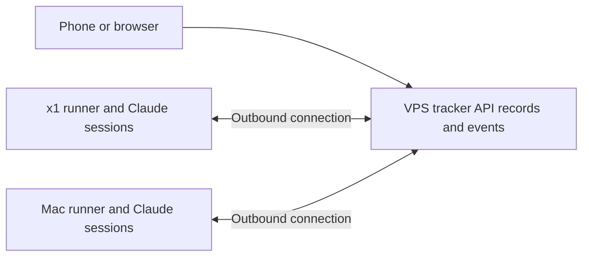

# Hosted Rooms architecture draft

Future scope supporting the [draft PRD](hosted-rooms-prd.md). No implementation or deployment is authorized by this document.

## Deployment shape

One small VPS hosts the owner page, API, authoritative room records, and durable event queue. Claude sessions and product worktrees continue to run on x1 and the Mac. Each host runs a connector that makes an outbound connection to the VPS; the VPS does not infer a remote session's state from its own process list.

## Records and execution

Proposed storage: SQLite for rooms, host assignments, cards, answers, commands, and delivery receipts. Export readable Markdown and retain Git history. The database is authoritative; local snapshots are not additional writers. A worker's existing direct-file editing workflow must be adapted to revision-checked API updates or explicit submission before migration.

Enforce one open room per repository per execution host with a database constraint and transaction. A room spanning several repositories claims each one atomically. Paused rooms keep their assignments; linked worktrees share the parent repository identity. Different repositories on the same host, and the same repository on different hosts, can each have an open room. The tracker shows them together. Do not enforce one global room per host or VPS.

Use stable command IDs, acknowledgements, and retry-safe processing. Record commands durably before delivery, fence stale runner ownership, and deduplicate execution as well as submissions. A runner reconnecting after sleep receives queued work without duplicating an already-running session. Keep transport acknowledgement distinct from the model having read the event.

Represent host connectivity separately from session activity. An offline Mac is not an idle agent. Authentication applies to reads and writes; a runner credential must not grant arbitrary control over other hosts.

## Owner page

Serve at one canonical URL and normalize trailing slashes. Scope API and service-worker paths correctly when mounted below a prefix. Keep drafts, editor nodes, focus, caret or selection, and viewport position stable across polling, answer receipts, and other background updates.

Use explicit card types for choices, prose answers, and completion tasks. Prose cards expose an editor and Send action. Completion cards accept observations with Done. Delivery receipts remain visible across refreshes.

## Operations

Start with a planning target of 2 GB RAM and 20 GB disk for the tracker only; benchmark before selecting a VPS. Run the service under systemd with restart-on-failure, log rotation, and health checks. Separate tracker restarts from runner and agent lifetimes.

Initially bind the application to loopback and publish private HTTPS access through Tailscale Serve. Authorize the intended owner for reads and writes. Public access, signup, and payment handling require a later design.

Back up the database consistently, including pending events and delivery state, and retain Markdown exports and Git history off the VPS. Demonstrate restoration to a fresh machine. Agree recovery targets and retention before migration.

## Migration and verification

Import existing room records without starting their agents, preserving IDs, dependencies, answers, and history. Connect one runner first, then a second. Resolve existing rooms that share the same repository on the same host explicitly before enabling new execution. Do not run two authoritative writers during cutover.

On 2026-10-30, a read-only inspection found runbum, routing-playground, and ronde unclosed on x1, and map-feedback open on the Mac. Recheck their repository assignments at migration time; several open rooms on a host are valid when they use different repositories. This observation does not authorize closing any of them.

Verify browser-to-API-to-record flows, interrupted submissions, duplicate command delivery, host sleep and reconnection, concurrent room creation, and backup restoration. Retain a rollback path that prevents both the old and new system from dispatching the same work.

## Future commercial discussion

At the next hosted-product or launch discussion, remind the owner that this could be a paid service and would need a polished, distinctive website. Pricing, onboarding, multi-tenancy, billing, and branding remain outside this draft's implementation scope.

## References

- [Current Rooms design](../design.md)
- [Tailscale Serve](https://tailscale.com/docs/features/tailscale-serve)
- [systemd service restart behavior](https://www.freedesktop.org/software/systemd/man/257/systemd.service.html)
